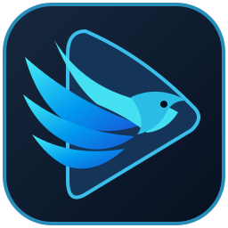

# Jatayu Media Player for Android

**Your media. Your space.**

Offline video, music and learning tools for Android smartphones and tablets.
Created by **Anup Kumar Yadav** · A **JatayuOS** project · Made in India.

[Website](https://jatayuos.in/apps/media-player/android/) · [हिन्दी](https://jatayuos.in/hi/apps/media-player/android/) · [Releases](../../releases) · [Support](https://jatayuos.in/support/)

## Android 1.0

Android 9+ (API 28), ARM64 phones and tablets. Target API 36. Install the signed
APK from Releases; Google Play distribution is planned separately.

- **Watch:** fullscreen, landscape, Fit/Fill, PiP, subtitles, speed, gestures and control lock.
- **Listen:** eight Studio presets, 10-band EQ, Bass/Vocals/Treble, preset strength,
  saved profiles, Original comparison, optional level matching, headroom and limiter.
- **Enjoy music:** live spectrum/pulse visuals, artwork, volume, optional crossfade,
  background playback and Android media controls.
- **Learn:** timestamped editable notes, export, bookmarks and adjustable A–B practice.
- **Organise:** local scan, file imports, search, folders, playlists, favourites and resume.
- **Feel at home:** English and Hindi. No ads, account or in-app analytics integration.

 

Screenshots show earlier test builds and media on the creator's device. The app
includes no songs or videos. Studio and crossfade operate with normal-speed
music; codec and output support depend on the device and backend.

## Source, licences and verification

This repository contains the reviewed Android source snapshot, not the private
development history. [Build instructions](BUILDING.md), [validation record](VALIDATION.md),
[privacy policy](docs/PRIVACY-POLICY.md), [credits](docs/ANDROID-THIRD-PARTY-NOTICES.md)
and the [GPL licence](LICENSE) accompany it. Releases include corresponding
dependency sources, full notices and SHA256SUMS.

Original application code is **GPL-3.0-or-later**. Third-party components retain
their own licences. The production certificate fingerprint is recorded in
[SIGNING-CERTIFICATE-SHA256.txt](SIGNING-CERTIFICATE-SHA256.txt).

**Test users:** the production certificate differs from the development key.
An in-place update will normally be rejected. Export study notes before
uninstalling a test build; uninstalling erases app-local data. Back up anything
you need first. Media files outside app storage are separate.

Android is the current focus. [Linux](https://jatayuos.in/apps/media-player/)
is maintained separately. Windows development has not started. Android TV is
outside this edition's scope.
